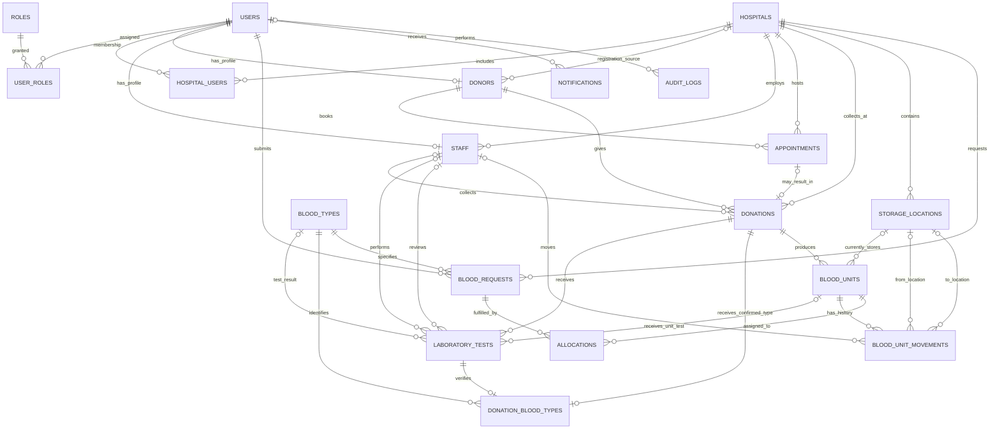

# Blood Bank Management System - Proposed Database Design

**Status: approved and implemented.** The Prisma schema includes the approved records, donor-registration hospital link, request review, compatibility attestation, and dispatch traceability. Applied migrations are additive and preserve existing data; the local development database is managed by the guarded `db:migrate:dev` script.

## Design assumptions

- UUID primary keys are used for application records. PostgreSQL generates them with `gen_random_uuid()`.
- All event times use `TIMESTAMPTZ`; date of birth is a calendar `DATE`.
- Record statuses are stored as short strings with PostgreSQL `CHECK` constraints. This is easier to update than PostgreSQL enums while requirements are still evolving.
- One staff profile belongs to one primary hospital. If staff commonly work at multiple hospitals, replace `staff.hospital_id` with a staff-hospital membership table before approval.
- Each blood request row asks for one blood type and one component. A request for multiple types or components is recorded as multiple request rows.
- New laboratory tests are attached to individual blood units and their parent donation. Older donation-level tests remain valid with no unit link. A blood type is recorded only after an ABO/Rh test is verified; units inherit it through their donation, avoiding a repeated blood-type column on each unit.
- Notifications store delivery metadata, not copies of message text or medical information.
- Backend permissions are defined in [PERMISSIONS.md](./PERMISSIONS.md). Hospital-user organization scope is represented by the additive `hospital_users` membership table.
- Donors registered by staff retain an optional registration-hospital link for hospital-scoped staff access. Public donor registration and older donor records may have no registration hospital.

### `hospital_users`

An explicitly provisioned link between a user account and a hospital. This membership is required to scope hospital-user access; a hospital ID supplied by a browser is not proof of membership.

| Column | Type | Rules |
|---|---|---|
| `id` | `UUID` | Primary key |
| `user_id` | `UUID` | Required; FK to `users.id` |
| `hospital_id` | `UUID` | Required; FK to `hospitals.id` |
| `is_active` | `BOOLEAN` | Required; default true; set false to revoke access without deleting its history |
| `created_at` | `TIMESTAMPTZ` | Required; default current time |

Use a unique constraint on `(user_id, hospital_id)` to prevent duplicate memberships and an index on `(hospital_id, is_active)` for hospital-scoped access checks. Assign the `HOSPITAL` role and this membership only through a trusted administrative process; public registration must not do either.

## Entity relationship diagram

In the diagram, `||` means one required record, `o|` means zero or one, and `o{` means zero or many.

## Tables and columns

Types below are PostgreSQL types. Unless stated otherwise, each table has an `id UUID PRIMARY KEY DEFAULT gen_random_uuid()`. Foreign keys should use `ON DELETE RESTRICT` so referenced operational history cannot be removed accidentally. Use deactivation and status changes instead of hard-deleting records.

### `users`

An application person's contact, account-status, and password-hash record. Session signing secrets are never stored in this table.

| Column | Type | Rules |
|---|---|---|
| `id` | `UUID` | Primary key |
| `email` | `VARCHAR(254)` | Required; unique case-insensitively |
| `password_hash` | `TEXT` | Optional until a credential is securely provisioned; never store a plaintext password |
| `display_name` | `VARCHAR(120)` | Required |
| `phone_e164` | `VARCHAR(16)` | Optional; validate as an international phone number |
| `account_status` | `VARCHAR(20)` | Required; default `pending`; check allowed statuses such as `pending`, `active`, `disabled` |
| `created_at` | `TIMESTAMPTZ` | Required; default current time |
| `updated_at` | `TIMESTAMPTZ` | Required; updated by the application |
| `disabled_at` | `TIMESTAMPTZ` | Optional; set instead of deleting a user |

Use a unique index on `lower(email)` so `Person@example.com` and `person@example.com` cannot create separate accounts. Normalize email casing in the application too.

### `roles`

The small set of role definitions, such as donor, staff, hospital user, or administrator. Role names do not grant behavior by themselves; the server-side policy is defined in [PERMISSIONS.md](./PERMISSIONS.md).

| Column | Type | Rules |
|---|---|---|
| `id` | `UUID` | Primary key |
| `code` | `VARCHAR(40)` | Required; unique stable code |
| `name` | `VARCHAR(80)` | Required |
| `description` | `TEXT` | Optional |
| `created_at` | `TIMESTAMPTZ` | Required; default current time |

### `user_roles`

An assignment history linking a user to a role. Revoking an assignment preserves its history.

| Column | Type | Rules |
|---|---|---|
| `id` | `UUID` | Primary key |
| `user_id` | `UUID` | Required; FK to `users.id` |
| `role_id` | `UUID` | Required; FK to `roles.id` |
| `assigned_by_user_id` | `UUID` | Optional; FK to `users.id` |
| `assigned_at` | `TIMESTAMPTZ` | Required; default current time |
| `revoked_by_user_id` | `UUID` | Optional; FK to `users.id` |
| `revoked_at` | `TIMESTAMPTZ` | Optional |

Check that `revoked_by_user_id` and `revoked_at` are either both null or both set. Add a partial unique index on `(user_id, role_id) WHERE revoked_at IS NULL` so a user cannot have the same active role twice.

### `hospitals`

Facilities that collect donations, host appointments, store units, or submit blood requests.

| Column | Type | Rules |
|---|---|---|
| `id` | `UUID` | Primary key |
| `name` | `VARCHAR(160)` | Required |
| `registration_number` | `VARCHAR(80)` | Optional; unique when supplied |
| `phone` | `VARCHAR(32)` | Optional |
| `email` | `VARCHAR(254)` | Optional |
| `address_line_1` | `VARCHAR(160)` | Optional |
| `address_line_2` | `VARCHAR(160)` | Optional |
| `city` | `VARCHAR(100)` | Optional |
| `region` | `VARCHAR(100)` | Optional |
| `postal_code` | `VARCHAR(20)` | Optional |
| `country_code` | `CHAR(2)` | Optional; ISO country code |
| `is_active` | `BOOLEAN` | Required; default true |
| `created_at` | `TIMESTAMPTZ` | Required; default current time |
| `updated_at` | `TIMESTAMPTZ` | Required; updated by the application |

### `staff`

Work profile for a user. Name, email, and phone remain in `users` and are not copied here.

| Column | Type | Rules |
|---|---|---|
| `id` | `UUID` | Primary key |
| `user_id` | `UUID` | Required; unique FK to `users.id` |
| `hospital_id` | `UUID` | Required; FK to `hospitals.id` |
| `employee_number` | `VARCHAR(40)` | Required; unique within a hospital |
| `job_title` | `VARCHAR(100)` | Optional |
| `staff_status` | `VARCHAR(20)` | Required; check allowed statuses such as `active`, `inactive` |
| `started_at` | `DATE` | Optional |
| `ended_at` | `DATE` | Optional; must not precede `started_at` |
| `created_at` | `TIMESTAMPTZ` | Required; default current time |

Unique constraint: `(hospital_id, employee_number)`.

### `donors`

Donor-specific profile. Contact details remain in `users`. Avoid adding broad medical-history or diagnosis fields without a specific approved need.

| Column | Type | Rules |
|---|---|---|
| `id` | `UUID` | Primary key |
| `user_id` | `UUID` | Required; unique FK to `users.id` |
| `donor_number` | `VARCHAR(40)` | Required; unique |
| `registration_hospital_id` | `UUID` | Optional; FK to the hospital where staff registered the donor |
| `date_of_birth` | `DATE` | Optional; collect only if required for eligibility and local policy |
| `donor_status` | `VARCHAR(20)` | Required; check allowed statuses such as `registered`, `active`, `deferred`, `inactive` |
| `eligibility_reviewed_at` | `TIMESTAMPTZ` | Optional |
| `consent_given_at` | `TIMESTAMPTZ` | Optional until consent is captured |
| `consent_version` | `VARCHAR(40)` | Optional; version of the consent notice |
| `created_at` | `TIMESTAMPTZ` | Required; default current time |
| `updated_at` | `TIMESTAMPTZ` | Required; updated by the application |
| `deactivated_at` | `TIMESTAMPTZ` | Optional; preserve the record rather than deleting it |

### `blood_types`

A controlled lookup table for supported ABO/Rh types. The rows themselves are reference data and should only be inserted after design approval.

| Column | Type | Rules |
|---|---|---|
| `id` | `UUID` | Primary key |
| `code` | `VARCHAR(6)` | Required; unique stable code |
| `abo_group` | `VARCHAR(2)` | Required; check one of `A`, `B`, `AB`, `O` |
| `rh_factor` | `CHAR(1)` | Required; check `+` or `-` |

Unique constraint: `(abo_group, rh_factor)`.

### `appointments`

A donor's planned visit at a facility. An appointment can be cancelled or completed without a donation.

| Column | Type | Rules |
|---|---|---|
| `id` | `UUID` | Primary key |
| `donor_id` | `UUID` | Required; FK to `donors.id` |
| `hospital_id` | `UUID` | Required; FK to `hospitals.id` |
| `created_by_user_id` | `UUID` | Optional; FK to `users.id` |
| `scheduled_start_at` | `TIMESTAMPTZ` | Required |
| `scheduled_end_at` | `TIMESTAMPTZ` | Required; later than start |
| `appointment_status` | `VARCHAR(20)` | Required; check allowed statuses such as `booked`, `cancelled`, `completed`, `missed` |
| `created_at` | `TIMESTAMPTZ` | Required; default current time |
| `updated_at` | `TIMESTAMPTZ` | Required; updated by the application |

Preventing overlapping bookings for a donor or room requires a scheduling rule. Start with a transaction-level application check; an approved later design can add PostgreSQL exclusion constraints if required.

### `donations`

A collection event. It can be linked to a booked appointment or recorded as a walk-in donation.

| Column | Type | Rules |
|---|---|---|
| `id` | `UUID` | Primary key |
| `donation_number` | `VARCHAR(40)` | Required; unique |
| `donor_id` | `UUID` | Required; FK to `donors.id` |
| `hospital_id` | `UUID` | Required; FK to `hospitals.id` |
| `collected_by_staff_id` | `UUID` | Optional; FK to `staff.id` |
| `appointment_id` | `UUID` | Optional; unique FK to `appointments.id` |
| `donation_status` | `VARCHAR(20)` | Required; check allowed statuses such as `collected`, `testing`, `released`, `discarded` |
| `collection_started_at` | `TIMESTAMPTZ` | Optional |
| `collected_at` | `TIMESTAMPTZ` | Optional until collection is completed |
| `volume_ml` | `SMALLINT` | Optional; positive when recorded |
| `created_at` | `TIMESTAMPTZ` | Required; default current time |

The unique appointment foreign key permits at most one donation per appointment. A null appointment represents a walk-in.

### `laboratory_tests`

Auditable test attempts linked to an individual blood unit for new workflow records. Older donation-level test rows remain intact with a null `blood_unit_id`. Result codes and blood-type results are highly sensitive and visible only to authorized administrators and blood bank staff.

| Column | Type | Rules |
|---|---|---|
| `id` | `UUID` | Primary key |
| `donation_id` | `UUID` | Required; FK to `donations.id` |
| `blood_unit_id` | `UUID` | Optional for legacy rows; composite FK with `donation_id` to ensure unit belongs to the same donation |
| `test_type` | `VARCHAR(40)` | Required; code configured by the organization; no clinical test list is assumed |
| `attempt_no` | `SMALLINT` | Required; greater than zero; unique per donation and test type |
| `performed_by_staff_id` | `UUID` | Optional; FK to `staff.id` |
| `reviewed_by_staff_id` | `UUID` | Optional until reviewed; FK to `staff.id` |
| `test_status` | `VARCHAR(20)` | Required; `pending`, `completed`, `failed`, or `invalid` |
| `review_status` | `VARCHAR(20)` | Required; defaults to `pending`; final values are `approved` or `rejected` |
| `result_code` | `VARCHAR(40)` | Optional coded outcome |
| `result_blood_type_id` | `UUID` | Optional; FK to `blood_types.id`; used for an ABO/Rh result |
| `sample_collected_at` | `TIMESTAMPTZ` | Optional |
| `performed_at` | `TIMESTAMPTZ` | Optional for legacy rows; required by the new workflow |
| `completed_at` | `TIMESTAMPTZ` | Optional |
| `reviewed_at` | `TIMESTAMPTZ` | Optional until a final review |
| `recorded_at` | `TIMESTAMPTZ` | Required; default current time |

Unique constraint: `(donation_id, test_type, attempt_no)`. Attempts for the same test type share a sequence across units of one donation, preserving the existing uniqueness rule.

Review actor and time are set together. Only a completed test with a result code can be approved; a failed test cannot be approved. The latest attempt for each configured and recorded type must be complete and approved before release. Earlier attempts remain in history and may be superseded by later attempts. No clinical result code is interpreted.

### `donation_blood_types`

The single confirmed blood type for a donation. This separates the measured result from the reusable type lookup and avoids repeating the type on every component unit.

| Column | Type | Rules |
|---|---|---|
| `donation_id` | `UUID` | Primary key and FK to `donations.id` |
| `blood_type_id` | `UUID` | Required; FK to `blood_types.id` |
| `verified_by_test_id` | `UUID` | Required; unique FK to `laboratory_tests.id` |
| `verified_at` | `TIMESTAMPTZ` | Required |

Before release, require that the verifying test is a completed ABO/Rh test for the same donation and that its `result_blood_type_id` equals this row's `blood_type_id`. Enforce this in the service transaction; a later SQL migration may strengthen it with composite foreign keys.

### `storage_locations`

A named storage place at a hospital, such as a refrigerator or freezer.

| Column | Type | Rules |
|---|---|---|
| `id` | `UUID` | Primary key |
| `hospital_id` | `UUID` | Required; FK to `hospitals.id` |
| `code` | `VARCHAR(40)` | Required; unique within the hospital |
| `name` | `VARCHAR(100)` | Required |
| `location_type` | `VARCHAR(30)` | Required; constrained code |
| `min_temperature_c` | `NUMERIC(4,1)` | Optional |
| `max_temperature_c` | `NUMERIC(4,1)` | Optional; if both limits are set, greater than minimum |
| `is_active` | `BOOLEAN` | Required; default true |
| `created_at` | `TIMESTAMPTZ` | Required; default current time |

Unique constraint: `(hospital_id, code)`.

### `blood_units`

An individually tracked product/component made from a donation. Its blood type is obtained through `donation_blood_types` using `donation_id`.

| Column | Type | Rules |
|---|---|---|
| `id` | `UUID` | Primary key |
| `donation_id` | `UUID` | Required; FK to `donations.id` |
| `unit_code` | `VARCHAR(60)` | Required; unique traceable label |
| `component_type` | `VARCHAR(30)` | Required; constrained code such as `whole_blood`, `red_cells`, `plasma`, `platelets` |
| `unit_status` | `VARCHAR(20)` | Required; check allowed statuses such as `quarantined`, `available`, `reserved`, `issued`, `expired`, `discarded` |
| `collected_at` | `TIMESTAMPTZ` | Required |
| `expires_at` | `TIMESTAMPTZ` | Required; later than collection |
| `current_storage_location_id` | `UUID` | Optional; FK to `storage_locations.id` |
| `created_at` | `TIMESTAMPTZ` | Required; default current time |
| `updated_at` | `TIMESTAMPTZ` | Required; updated by the application |

Index inventory searches by `(unit_status, expires_at)` and `(donation_id)`. Do not make a storage location mandatory: a unit may be in transit or issued. Units created from a collection are always quarantined.

The collection's `hospital_id` is the recorded collection facility. The expiry date is supplied by the authorized operator based on the organization's approved procedure; the application does not calculate clinical shelf life.

Release requirements are configured in the server-only `BLOOD_UNIT_REQUIRED_TEST_TYPES` environment variable as comma-separated codes. An empty value deliberately blocks release until the organization supplies its approved list; this setting does not establish a testing protocol or result threshold.

### `blood_requests`

One hospital request for a quantity of one blood type and one component. Do not place diagnoses or patient names in request details; introduce a carefully scoped recipient record only if a later approved requirement needs it.

| Column | Type | Rules |
|---|---|---|
| `id` | `UUID` | Primary key |
| `request_number` | `VARCHAR(40)` | Required; unique |
| `hospital_id` | `UUID` | Required; FK to `hospitals.id` |
| `requested_by_user_id` | `UUID` | Required; FK to `users.id` |
| `blood_type_id` | `UUID` | Required; FK to `blood_types.id` |
| `component_type` | `VARCHAR(30)` | Required; same controlled component codes as units |
| `quantity_requested` | `SMALLINT` | Required; greater than zero |
| `priority` | `VARCHAR(16)` | Required; constrained code such as `routine`, `urgent`, `emergency` |
| `request_status` | `VARCHAR(20)` | Required; `open`, `approved`, `rejected`, `partially_fulfilled`, `fulfilled`, `cancelled`, or `expired` |
| `request_details` | `VARCHAR(1000)` | Optional for legacy rows; required by the API for new submissions; operational details only |
| `reviewed_by_user_id` | `UUID` | Optional; FK to `users.id`; paired with `reviewed_at` |
| `reviewed_at` | `TIMESTAMPTZ` | Optional; review timestamp |
| `review_note` | `VARCHAR(1000)` | Optional; required when staff rejects a request |
| `requested_at` | `TIMESTAMPTZ` | Required; default current time |
| `needed_by` | `TIMESTAMPTZ` | Optional |
| `updated_at` | `TIMESTAMPTZ` | Required; updated by the application |
| `closed_at` | `TIMESTAMPTZ` | Optional |

New requests start as `open`. Only an administrator or staff member in the hospital scope may approve or reject one. Allocation is allowed only after approval. Cancellation is allowed only before an active allocation exists. Every request status change is retained in `blood_request_status_history`.

### `blood_request_status_history`

Append-only status transitions for a request, with the authenticated actor, time, and optional note. The request owner and authorized staff can view the history; there are no update/delete API operations.

| Column | Type | Rules |
|---|---|---|
| `id` | `UUID` | Primary key |
| `blood_request_id` | `UUID` | Required; FK to `blood_requests.id` |
| `changed_by_user_id` | `UUID` | Required; FK to `users.id` |
| `previous_status` | `VARCHAR(24)` | Optional; null for initial submission |
| `new_status` | `VARCHAR(24)` | Required; constrained request status |
| `note` | `VARCHAR(1000)` | Optional |
| `changed_at` | `TIMESTAMPTZ` | Required; default current time |

### `blood_compatibility_approvals`

An administrator-recorded attestation that a qualified reviewer reviewed the exact ABO/Rh matching policy. Allocation is disabled unless one active attestation exists. The application compares exact ABO/Rh groups and components; it does not implement broader compatibility rules.

| Column | Type | Rules |
|---|---|---|
| `id` | `UUID` | Primary key |
| `policy_version` | `VARCHAR(80)` | Required |
| `policy_description` | `VARCHAR(1000)` | Required; must attest to exact ABO/Rh matching |
| `reviewer_name` | `VARCHAR(160)` | Required; qualified reviewer |
| `reviewer_credential` | `VARCHAR(160)` | Required; administrator-entered attestation |
| `reviewed_at` | `TIMESTAMPTZ` | Required; cannot be in the future |
| `recorded_by_user_id` | `UUID` | Required; FK to `users.id` |
| `is_active` | `BOOLEAN` | Required; only one active record at a time |
| `recorded_at` | `TIMESTAMPTZ` | Required; default current time |

### `allocations`

The join between a request and a specific blood unit. It provides allocation history and supports multiple units for one request.

| Column | Type | Rules |
|---|---|---|
| `id` | `UUID` | Primary key |
| `blood_request_id` | `UUID` | Required; FK to `blood_requests.id` |
| `blood_unit_id` | `UUID` | Required; FK to `blood_units.id` |
| `allocated_by_user_id` | `UUID` | Required; FK to `users.id` |
| `allocation_status` | `VARCHAR(20)` | Required; constrained code such as `reserved`, `fulfilled`, `cancelled` |
| `allocated_at` | `TIMESTAMPTZ` | Required; default current time |
| `fulfilled_at` | `TIMESTAMPTZ` | Optional |
| `cancelled_at` | `TIMESTAMPTZ` | Optional |

Use a partial unique index on `blood_unit_id` where status is `reserved` or `fulfilled`: a unit cannot be reserved twice or issued to two requests. Cancelled allocations remain as historical rows, and a cancelled unit can be allocated again only after it has returned to an eligible inventory state. In one transaction, lock both request and unit rows and check request quantity, approved request status, exact ABO/Rh and component matching, the active policy attestation, laboratory release state, unit status, and expiration.

### `blood_dispatches`

One dispatch record for an allocation. The composite foreign key ensures that the selected allocation, request, and unit are the same linked records. A unique allocation constraint prevents dispatching the same allocation twice.

| Column | Type | Rules |
|---|---|---|
| `id` | `UUID` | Primary key |
| `allocation_id` | `UUID` | Required; unique FK to the matching allocation |
| `blood_request_id` | `UUID` | Required; FK to `blood_requests.id` |
| `blood_unit_id` | `UUID` | Required; FK to `blood_units.id` |
| `dispatched_by_user_id` | `UUID` | Required; FK to `users.id` |
| `dispatched_by_staff_id` | `UUID` | Required; FK to an active staff profile at the request's hospital |
| `delivery_status` | `VARCHAR(20)` | `dispatched`, `delivered`, `returned`, or `discarded` |
| `dispatched_at` | `TIMESTAMPTZ` | Required; default current time |
| `delivered_at` | `TIMESTAMPTZ` | Optional; populated on final delivery/disposition |
| `final_disposition` | `VARCHAR(40)` | Required for terminal outcomes; constrained by status |

Delivered records distinguish `transfused` from `not_transfused`. Returned units are set to `quarantined`, and discarded units are set to `discarded`; neither is automatically made available. A returned or discarded allocation is marked cancelled while its dispatch record remains, allowing any replacement allocation to be recorded without erasing dispatch history.

### `blood_dispatch_status_history`

Append-only dispatch status changes with the actor, time, and recorded final disposition. Only the server can append a transition; dispatch history cannot be deleted through the API.

| Column | Type | Rules |
|---|---|---|
| `id` | `UUID` | Primary key |
| `blood_dispatch_id` | `UUID` | Required; FK to `blood_dispatches.id` |
| `changed_by_user_id` | `UUID` | Required; FK to `users.id` |
| `previous_status` | `VARCHAR(20)` | Optional; null for initial dispatch |
| `new_status` | `VARCHAR(20)` | Required; constrained dispatch status |
| `final_disposition` | `VARCHAR(40)` | Optional until a terminal status |
| `note` | `VARCHAR(1000)` | Optional |
| `changed_at` | `TIMESTAMPTZ` | Required; default current time |

### `blood_unit_movements`

An append-only record of each move, so changing a unit's current location does not erase its past locations.

| Column | Type | Rules |
|---|---|---|
| `id` | `UUID` | Primary key |
| `blood_unit_id` | `UUID` | Required; FK to `blood_units.id` |
| `from_storage_location_id` | `UUID` | Optional; FK to `storage_locations.id` |
| `to_storage_location_id` | `UUID` | Optional; FK to `storage_locations.id` |
| `moved_by_staff_id` | `UUID` | Optional; FK to `staff.id` |
| `moved_at` | `TIMESTAMPTZ` | Required; default current time |
| `reason_code` | `VARCHAR(30)` | Optional constrained code |

At least one of the from/to locations must be set, and if both are set they must differ. A single transaction should insert this history row and update `blood_units.current_storage_location_id`.

### `notifications`

Delivery state for a notification sent to a user. Resolve the message from a template in the application; do not persist a copy containing personal or medical details.

| Column | Type | Rules |
|---|---|---|
| `id` | `UUID` | Primary key |
| `user_id` | `UUID` | Required; FK to `users.id` |
| `notification_type` | `VARCHAR(40)` | Required constrained event code |
| `channel` | `VARCHAR(16)` | Required; constrained code such as `email`, `sms`, `in_app` |
| `delivery_status` | `VARCHAR(20)` | Required; constrained code such as `queued`, `sent`, `failed`, `read` |
| `created_at` | `TIMESTAMPTZ` | Required; default current time |
| `sent_at` | `TIMESTAMPTZ` | Optional |
| `read_at` | `TIMESTAMPTZ` | Optional |

### `audit_logs`

Append-only metadata describing who did what and when. Do not store passwords, tokens, full before/after row contents, test results, or message bodies here.

| Column | Type | Rules |
|---|---|---|
| `id` | `UUID` | Primary key |
| `actor_user_id` | `UUID` | Optional; FK to `users.id`; null for system actions |
| `action` | `VARCHAR(40)` | Required action code |
| `entity_type` | `VARCHAR(50)` | Required table/entity code |
| `entity_id` | `UUID` | Required identifier of the changed record |
| `occurred_at` | `TIMESTAMPTZ` | Required; default current time |
| `request_id` | `UUID` | Optional request/correlation identifier |
| `changed_fields` | `TEXT[]` | Required; default empty array; names only, never values |
| `metadata` | `JSONB` | Required; default empty object; allow-list non-sensitive keys only |

`entity_id` intentionally has no foreign key because it refers to different tables depending on `entity_type`. Restrict update/delete permissions on this table to preserve the audit trail.

## Relationships in simple English

- A user can have several roles. `user_roles` records each assignment and when it was revoked.
- A user can have one donor profile, one staff profile, both, or neither.
- A donor profile can record zero or one registration hospital. This link supports staff scope; appointments and donations can also establish the staff member's relationship to a donor.
- Each staff profile is attached to one hospital under this proposal. A hospital can have many staff.
- A donor can book many appointments and make many donations. Each appointment belongs to one donor and one hospital.
- An appointment may result in zero or one donation. Walk-in donations do not need an appointment.
- A donation belongs to one donor and one hospital. A staff member can be recorded as its collector.
- A donation can have several laboratory-test attempts. Each attempt can record a coded result and, for ABO/Rh testing, a blood type.
- A donation has at most one confirmed blood type. Its verifying test must be the completed ABO/Rh result for that donation. Blood units obtain their type through this relationship.
- A donation can produce multiple blood units, such as separate components.
- A hospital can have many storage locations; each unit has at most one current location. Movement records preserve prior locations.
- A hospital can submit many blood requests. Each request is submitted by a user and asks for one type/component combination.
- An allocation connects one requested item to one blood unit. A request can receive many units; a unit can have only one active or completed allocation.
- A request has an append-only status history and may have a qualified-review compatibility attestation.
- A dispatch belongs to one allocation, the same request, and the same blood unit. Delivery outcomes and final disposition are retained in a separate append-only history.
- A user can receive many notifications and can perform many audited actions.

## Important constraints and indexes

In addition to the per-table rules above, create indexes for frequent lookups:

- `user_roles(user_id)` and `user_roles(role_id)`; partial unique active role assignment.
- `staff(hospital_id)`; unique `(hospital_id, employee_number)`.
- `donors(user_id)`, unique `donor_number`, and `donors(registration_hospital_id)`.
- `appointments(donor_id, scheduled_start_at)` and `(hospital_id, scheduled_start_at)`.
- `donations(donor_id, collected_at DESC)` and `(hospital_id, collected_at DESC)`.
- `laboratory_tests(donation_id, test_type, recorded_at DESC)`.
- `blood_units(unit_status, expires_at)` and `blood_units(donation_id)`.
- `blood_requests(hospital_id, request_status, needed_by)` and `(blood_type_id, component_type, request_status)`.
- `blood_request_status_history(blood_request_id, changed_at)`.
- Partial unique `allocations(blood_unit_id)` for `reserved` or `fulfilled` rows, plus `(blood_request_id, allocation_status)`.
- `blood_compatibility_approvals(is_active)` has a partial unique index that allows at most one active attestation.
- `blood_dispatches(blood_request_id, dispatched_at)` and `(blood_unit_id, dispatched_at)`; unique allocation linkage and composite request/unit/allocation linkage.
- `blood_dispatch_status_history(blood_dispatch_id, changed_at)`.
- `blood_unit_movements(blood_unit_id, moved_at DESC)`.
- `notifications(user_id, delivery_status, created_at DESC)`.
- `audit_logs(entity_type, entity_id, occurred_at DESC)` and `(actor_user_id, occurred_at DESC)`.

Foreign-key columns should be indexed where they are used for joins or delete/update checks. Verify exact index syntax and Prisma support during implementation. For case-insensitive email uniqueness, a PostgreSQL expression index may require custom SQL in the approved migration.

## Sensitive data and historical records

Treat these as sensitive:

- User email addresses and telephone numbers.
- Donor birth date, consent, donor status, and eligibility review information.
- Donation history, blood type, laboratory results, and any staff identity linked to a test.
- Staff employment identifiers and role assignments.
- Notification delivery metadata when it can reveal a person's participation.
- Audit actor and entity identifiers; UUIDs do not make a record anonymous.

Protect them with least-privilege database roles, TLS connections, encrypted backups and storage, restricted access to test results, and access logging. Do not write connection URLs, secrets, personal details, or laboratory values to application logs. Avoid collecting a patient name or diagnosis unless a specific approved requirement and privacy process demand it.

Preserve donation, test-attempt, unit, request, allocation, movement, role-assignment, and audit history. Correct an incorrect test by adding a new attempt or a separately audited correction rather than silently overwriting the old result. Deactivate accounts, profiles, hospitals, and locations instead of deleting rows that are referenced by history. Define retention periods, backup expiry, and any legally required erasure or pseudonymization with the applicable jurisdiction and institution before production use.

## Future design decisions

These questions may need to be revisited before implementing the corresponding workflows or changing the approved schema:

1. Is one primary hospital per staff member sufficient, or must staff work at multiple hospitals?
2. Are donor appointments allowed to produce at most one donation?
3. Are all lab tests donation-level, or must some tests attach to individual components?
4. Is a request always one blood type and component, as modeled here?
5. Which fields and retention periods are legally required for donor eligibility, consent, laboratory records, and audit?
6. Which exact role codes, status values, component types, test codes, and blood types should be allowed?
